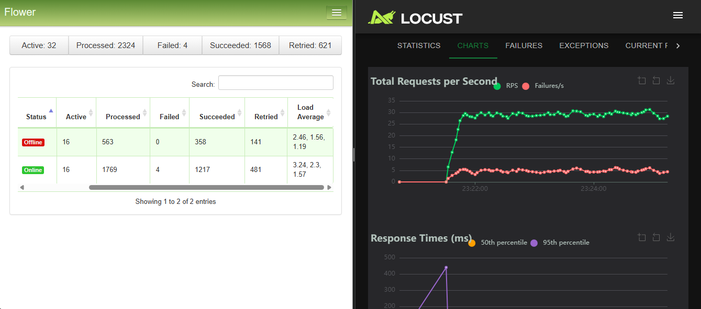
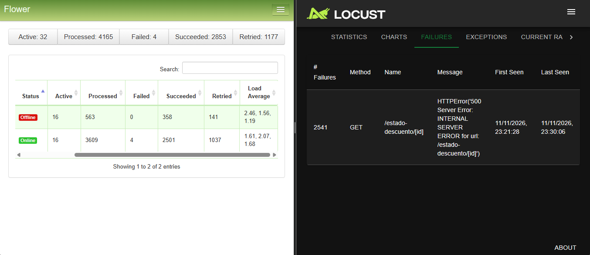

# 📊 Reporte SRE: Arquitectura Asíncrona Resiliente

**Proyecto / Repositorio:** NeoChaos (Rama `11/11`)  
**Equipo de trabajo:**

- Juan Esteban Robledo Forero
- Diego Fernando Castillo Cruz
- Juan David Casanova Melo
- Nicolas Steven Prieto Gomez

**Fecha:** 11 de noviembre de 2026

---

## 1. Resumen de la Arquitectura Implementada

Para mitigar los bloqueos en Gunicorn y los errores `502 Bad Gateway` / `504 Gateway Timeout` ocasionados por la latencia (1 a 4 segundos) e inestabilidad (30% de tasa de fallo) de la pasarela bancaria externa, se desacopló el flujo transaccional hacia una arquitectura orientada a eventos:

- **Balanceador de Carga (`Nginx`):** Distribuye el tráfico entrante hacia las réplicas de la API sin bloquear conexiones.
- **API Web (`Flask` + `Gunicorn`):** Recibe las peticiones en `/aplicar-descuento` (o `/comprar-ticket`), encola la tarea en el broker de forma no bloqueante y responde inmediatamente con código **HTTP `202 Accepted`** y un `task_id`.
- **Message Broker & Result Backend (`Redis`):** Gestiona la cola de mensajes y almacena los estados de ejecución (`PENDING`, `RETRY`, `SUCCESS`, `FAILURE`).
- **Workers Asíncronos (`Celery`):** Procesan la pasarela bancaria en segundo plano implementando:
  - **Patrón de Reintentos (_Retry Pattern_):** `bind=True`, `max_retries=3` y un retraso (`countdown=2`) de 2 segundos ante fallos del banco.
  - **Control de Tiempo (_Soft Time Limit_):** `soft_time_limit=5` para abortar de forma segura peticiones bancarias colgadas.
- **Observabilidad en Tiempo Real (`Flower`):** Desplegado en el puerto `5555` para auditar workers activos, tareas en cola y ciclos de reintento.

---

## 2. Evidencia Visual Dual (Locust + Flower)

## 

---

## 3. Análisis de Resultados de la Prueba de Estrés

### A. Nivel Web (Locust)

- **Desacoplamiento exitoso:** Las peticiones `POST` de solicitud obtuvieron respuesta inmediata (`202 Accepted`) con tiempos de latencia en milisegundos, evitando la caída de los contenedores de la API bajo alta concurrencia.
- **Comportamiento del Polling (`/estado-descuento/<task_id>`):** Los códigos `500` registrados en la pestaña _Failures_ corresponden exclusivamente a las consultas de estado sobre transacciones que agotaron sus 3 reintentos frente al banco simulado, lo cual valida el correcto manejo de excepciones y notificación de rechazo al cliente.

### B. Nivel Worker y Resiliencia (Flower)

- **Total de tareas procesadas:** `1,739` en la primera captura y `3,609` en la segunda captura
- **Tareas completadas con éxito (`Succeeded`):** `1,212` en la primera captura y `2,501` en la segunda captura
- **Tareas recuperadas mediante reintentos (`Retried`):** `481` en la primera captura y `1,037` en la segunda captura — _Demuestra que aproximadamente un cuarto de las transacciones sufrieron el fallo simulado del 30% del banco, pero fueron rescatadas automáticamente por Celery sin intervención manual ni pérdida de datos._
- **Tareas fallidas definitivamente (`Failed`):** `4` — _Transacciones que superaron el umbral máximo de 3 reintentos consecutivos._

---

## 4. Conclusión SRE

La transición de un modelo síncrono a una arquitectura asíncrona con **Redis, Celery y Flower** eliminó el cuello de botella en la capa web. El sistema absorbió picos de tráfico concurrente manteniendo la disponibilidad del servicio, aislando los fallos de terceros mediante reintentos controlados y garantizando visibilidad operativa en tiempo real.
